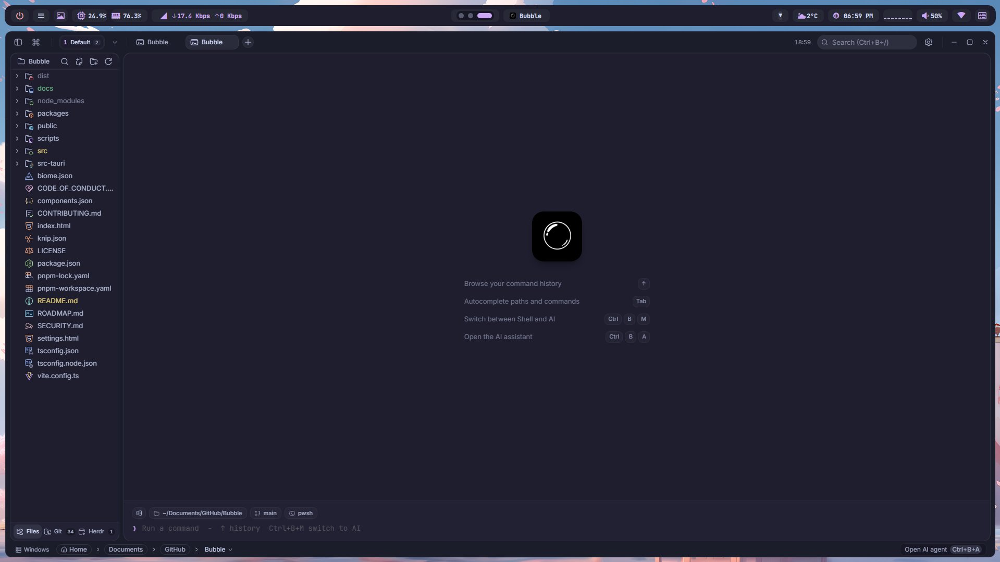
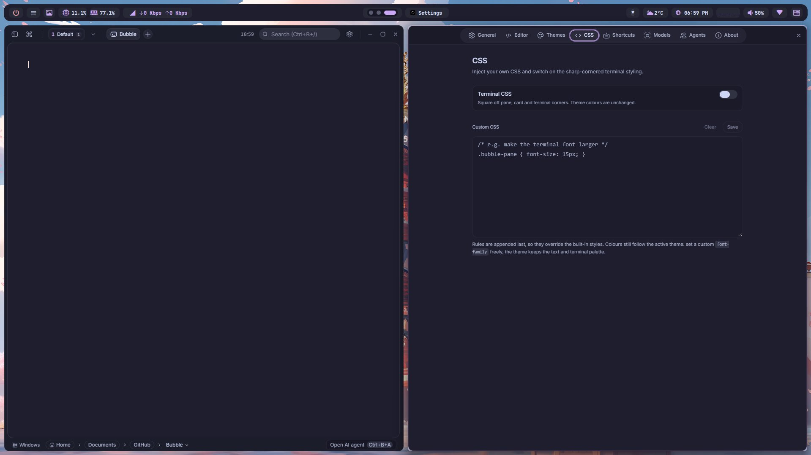
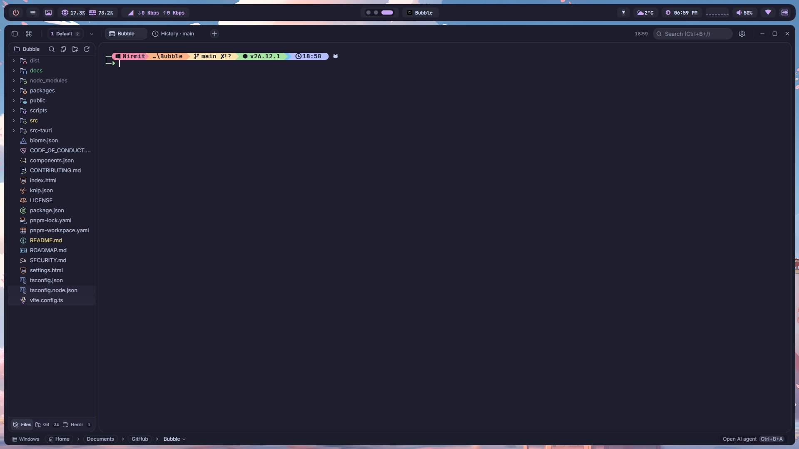
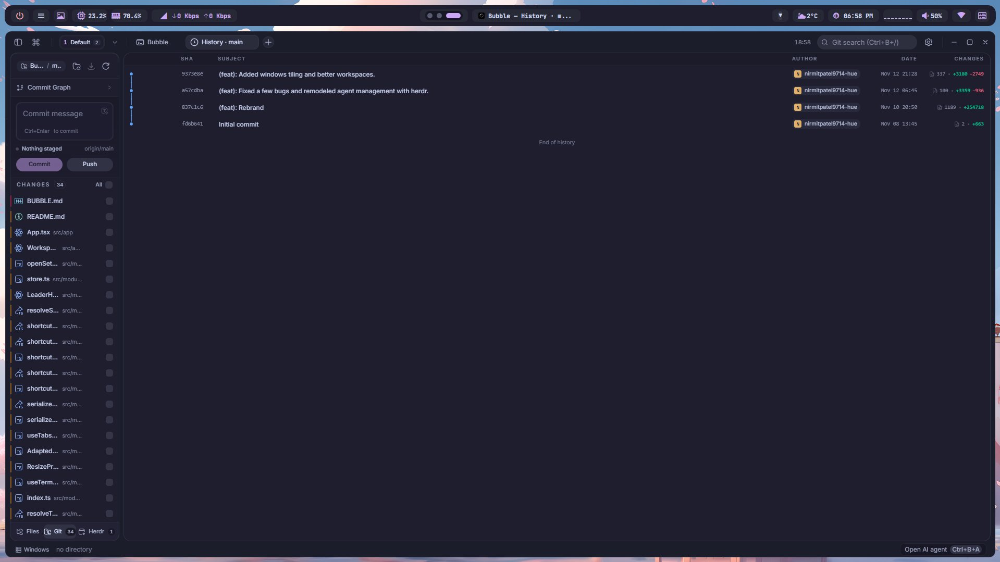

# Bubble


**The only app you need. For all dev.**
(forked from terax)

Bubble is a GPU-accelerated desktop workspace for developers: a fast terminal,
a code editor, AI assistants, and workspaces — in one window, built with Tauri,
React, and a WebGPU terminal renderer.

---

## Demo

<video src="docs/demo.mp4" controls="controls" width="100%"></video>

> [!NOTE]
> Demo recording: [`docs/demo.mp4`](docs/demo.mp4)

---

## Screenshots

| Workspaces & tabs | Custom CSS |
| --- | --- |
|  |  |

| Terminal | Git history |
| --- | --- |
|  |  |

---

## Features

- **GPU terminal** — a WebGPU-rendered terminal with a full VT/xterm engine,
  OSC 133 shell integration, block mode, and a searchable scrollback.
- **Workspaces** — group tabs into isolated workspaces, each with its own
  working directory and environment.
- **Tabs & tiling** — stack tabs or tile them into niri-style scrolling columns.
- **Editor** — CodeMirror-based editor with LSP diagnostics, autocomplete,
  Git diffs, and a file explorer.
- **AI** — bring your own model/endpoint, chat, inline edits, and agent
  sessions.
- **Command palette** — every action is one keystroke away.
- **Themes** — built-in themes plus importable custom themes; customize the
  terminal font, colors, and CSS.
- **Cross-platform** — Windows, macOS, and Linux.

---

## Quick start

### Prerequisites

- [Node.js](https://nodejs.org/) **22 or newer**
- [pnpm](https://pnpm.io/) 11
- The [Tauri prerequisites](https://tauri.app/start/prerequisites/) for your OS
  (Rust toolchain, and on Linux the WebKitGTK/webkit2gtk packages).

### Install

```bash
pnpm install
```

### Run in development

```bash
pnpm tauri dev
```

`pnpm dev` starts only the Vite web layer (no native window); use
`pnpm tauri dev` for the real app.

### Build a release

```bash
pnpm tauri build
```

Bundles are written to `src-tauri/target/release/bundle/`.

Release builds produce signed updater artifacts (`createUpdaterArtifacts: true`), which require the updater signing key in `TAURI_SIGNING_PRIVATE_KEY`. The key lives outside the repo at `%USERPROFILE%\.tauri\bubble-updater.key` (set as a user environment variable pointing to that path) and its public half is committed in `src-tauri/tauri.conf.json` (`plugins.updater.pubkey`). If the key is ever regenerated, update the `pubkey` — and re-install any existing app build, since old installs verify updates against the key they shipped with.

### Useful scripts

| Command | What it does |
| --- | --- |
| `pnpm tauri dev` | Run the desktop app in development |
| `pnpm build` | Type-check and build the web assets |
| `pnpm test` | Run the Vitest suite |
| `pnpm check-types` | `tsc --noEmit` |
| `pnpm lint` | Biome lint over `src` |
| `pnpm format` | Biome format `src` |

---

## Using Bubble

### Workspaces

A **workspace** is a named group of tabs with its own directory and shell
environment. Create one from the workspace switcher, then open terminals and
files inside it. Switching workspaces keeps every session alive in the
background.

### Tabs and tiling

- Open a terminal with the **+** button or the command palette.
- Drag a tab onto another to split/tiling, or use the tiling toggle to lay tabs
  out as equal columns.
- Tiled tabs are a horizontally scrollable row: the active column is scrolled
  to the center, and each column keeps a fixed width so it never stretches with
  the window. Use `Shift+mouse wheel` (or the trackpad) to scroll the row.

### Terminal

- Type commands as usual; the shell prompt is redrawn on resize.
- **Block mode** turns command output into collapsible blocks.
- Search the scrollback from the terminal toolbar.
- The terminal font, size, weight, cursor, and scrollback are in
  **Settings → General → Terminal**.

### Editor

- Open files from the explorer or with the command palette.
- LSP diagnostics, autocomplete, and formatting are configurable in
  **Settings → Editor**.

### AI

- Add a provider/endpoint and model in **Settings → Models**.
- Open the AI panel to chat, run inline edits, or start an agent session.

### Command palette

Press **Ctrl+Space** anywhere to open the command palette. Type to filter
commands, files, and content actions.

### Leader shortcuts

Most actions are leader chords: press the **leader** (default **Ctrl+B**),
release, then press the chord key. Change the leader key in
**Settings → Shortcuts**. Every binding is rebindable there too.

### Themes and CSS

- **Settings → Themes** — pick a built-in theme, import a custom theme, or edit
  theme colors and the terminal font.
- **Settings → CSS** — inject your own CSS, and toggle **Terminal CSS** for
  sharp, square corners. Theme colors are preserved; a custom `font-family`
  never repaints the palette.

---

## Keyboard shortcuts

| Action | Default |
| --- | --- |
| Command palette | `Ctrl+Space` |
| Leader | `Ctrl+B` |
| New terminal | `Ctrl+B` then `N` |
| New window/tab | `Ctrl+B` then `O` |
| Next / previous window | `Ctrl+B` then `→` / `←` |
| Next / previous workspace | `Ctrl+B` then `Space` |
| Open settings | `Ctrl+B` then `,` |
| Clear terminal | `Ctrl+B` then `Shift+K` |
| Toggle sidebar | `Ctrl+B` then `Shift+B` |
| Editor undo / redo / save | `Ctrl+Z` / `Ctrl+Y` (or `Ctrl+Shift+Z`) / `Ctrl+S` |

On macOS the editor chords use `Cmd` instead of `Ctrl`. Leader chords never use
Alt or Super, so they never collide with terminal control bytes.

---

## Contributing

Thanks for your interest in Bubble! Bug reports, feature requests, and pull
requests are welcome.

1. Fork the repo and create a branch.
2. `pnpm install`
3. Make your change; add or update tests where it makes sense.
4. Run `pnpm check-types`, `pnpm lint`, and `pnpm test`.
5. Open a pull request against `main` describing the change.

Please keep commits focused and follow the existing code style (Biome handles
formatting). By contributing you agree to license your work under the project's
[Apache-2.0](LICENSE) license.

### Sponsors & advertising

Bubble is free and open source. Sponsorship and advertising keep development
going. If you'd like to sponsor the project or place an ad in the README, open
an issue titled **Sponsor** or **Advertise** and we'll follow up.

<!-- Advertisement slots (replace with real sponsor links/creatives):
- [ Your logo here ] — 970×90 leaderboard
- [ Your logo here ] — 300×250 sidebar
-->

| Sponsor slot | Size |
| --- | --- |
| _Your logo here_ | 970×90 leaderboard |
| _Your logo here_ | 300×250 sidebar |

---

## License

Apache-2.0. See [LICENSE](LICENSE).
